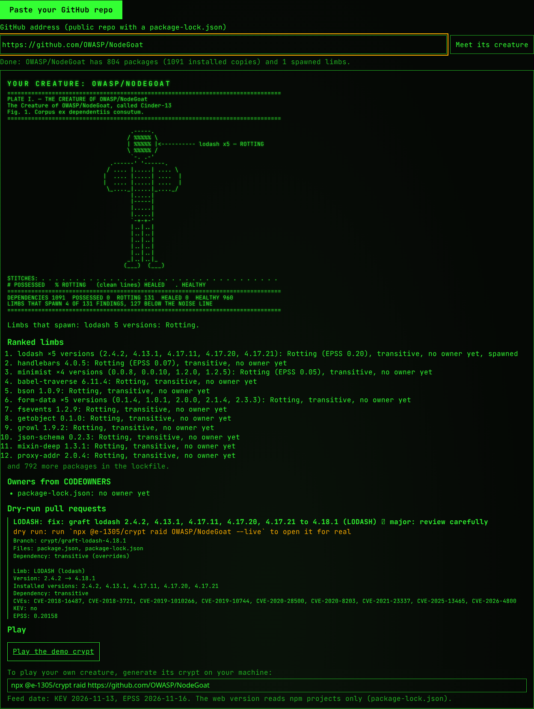
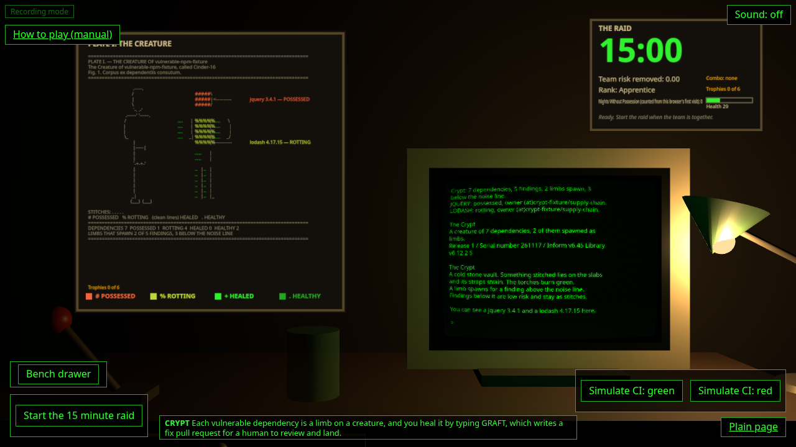

[](https://github.com/e-1305/Crypt/actions/workflows/ci.yml)

# CRYPT
### Don't abandon your creature.

**The problem:** 248 findings across 20 popular repos, 95.2% were noise, and 84.7% of dependencies had no owner ([census](docs/census/RESULTS.md)).

**CRYPT:** finds the few vulnerable dependencies that matter, names an owner from CODEOWNERS, opens one fix PR, and a human merges.

**Proof:** [lodash 4.17.15 to 4.18.1, CI green, merged by a human](https://github.com/e-1305/crypt-demo/pull/1).

**Zork that patches your code, and can never break it.**

**Live demo: [e-1305.github.io/Crypt](https://e-1305.github.io/Crypt/)** · [How it works in 60 seconds](https://e-1305.github.io/Crypt/manual.html#how-it-works) · [Pitch](docs/PITCH.md)

```bash
npx @e-1305/crypt raid <path-or-github-url>     # dry run by default: nothing is sent, a human lands every PR
npm ci && npx --no-install crypt raid fixtures/vulnerable-npm --offline     # from a checkout, no network after the first toolchain build
```

On the live demo the first screen is the creature plate, the CRT, the pitch and one button, "Paste your GitHub repo": paste a public npm repo and meet its creature in the browser, with dry-run pull request payloads (npm `package-lock.json` only). The raid, Simulated CI, gallery and recording mode sit in the Bench drawer.



If `npx @e-1305/crypt` reports that the package is not found, it has not been published yet (maintainers: see [docs/RELEASE.md](docs/RELEASE.md)). Use the checkout form until then.



Screenshot from the headless harness (`scripts/playtest/judge.mjs`, software WebGL, 1280x720). Scope: Tier 1, npm and pip lockfiles only.

CRYPT turns your dependency tree into a creature, one limb per package.
Limbs with known vulnerabilities rot. Limbs with actively exploited vulnerabilities (CISA KEV) are *possessed*.
You heal them by playing a real **Z-machine** text adventure (Infocom's 1979 virtual machine).
Each command dispatches AI agents built with [Kiro](https://kiro.dev) that open a fix PR. A limb only heals when CI is green **and a human merges**.

> 🎃 Built for [Kiroween 2026](https://kiroween.devpost.com/), Frankenstein track.

---

**New here? Read the [user manual](docs/USER_MANUAL.md), also hosted at [e-1305.github.io/Crypt/manual.html](https://e-1305.github.io/Crypt/manual.html).**

**Already have a scanner report?** Import SARIF, Dependabot, Trivy, Grype or Snyk output: [docs/INTEGRATIONS.md](docs/INTEGRATIONS.md).

## Live demo

**[e-1305.github.io/Crypt](https://e-1305.github.io/Crypt/)**: the first vulnerability report you can play. The page opens on a demo creature built offline from `fixtures/crypt-demo`, a snapshot of [e-1305/crypt-demo](https://github.com/e-1305/crypt-demo) at commit `bd82e8e` (owner @e-1305), with its plate and a playable story. A gallery lists 20 public projects, each with its own creature. "Download the playable report" saves the loaded `.z8`, which any Z-machine interpreter (Frotz, Lectrote, Parchment) opens.

**Views** (linked from the landing page, all in the same site): [Play](https://e-1305.github.io/Crypt/) · [War Room](https://e-1305.github.io/Crypt/war-room.html) (simulated big-screen raid) · [Graveyard](https://e-1305.github.io/Crypt/graveyard/graveyard.html) (`graveyard/` also works) · [CISO report (sample)](https://e-1305.github.io/Crypt/autopsy.html) (labelled SAMPLE DATA, the output of `crypt autopsy --sample`).

GRAFT on the page is a rehearsal: it shows the dry-run pull request payload and sends nothing.

Maintainers: set Settings > Pages > Source to **GitHub Actions** once. `.github/workflows/pages.yml` then deploys on every push to `main`.

## Install

```bash
npm install --global @e-1305/crypt     # gives the `crypt` command
crypt raid <path-or-github-url>
```

Or run it once without installing: `npx @e-1305/crypt raid <path-or-github-url>`.
Node 20 or newer. The package is `@e-1305/crypt` because the names `crypt` and `crypt-cli` belong to unrelated packages on the npm registry. The command it installs is still `crypt`.

## Quickstart

From a checkout of this repository:

```bash
npm ci
npx --no-install crypt raid fixtures/vulnerable-npm --offline   # or: npx --no-install crypt exhume <path-or-github-url>
```

Type `GRAFT JQUERY` at the game prompt: a dry-run fix payload lands in `out/prs/`. Type `SEAL CRYPT`, and every later graft is rejected.
`crypt raid` builds the Inform 6 and dfrotz toolchain once into `~/.cache/crypt/toolchain` (override with `CRYPT_TOOLCHAIN_DIR`; needs git, make, a C compiler and network the first time).
Run it from any directory: `out/`, `crypt-audit.log` and `.crypt-seal` are written to the current one.

Inside a checkout or a project that has the package installed, use `npx --no-install crypt`: it runs the local command and never downloads another package. Outside a project, use `npx @e-1305/crypt`.
`crypt --help` lists every command and flag. `exhume` of a GitHub URL shallow-clones it into a temporary directory, reads the lockfile and CODEOWNERS only, runs nothing from it, installs nothing, and removes the clone.
`bash scripts/ci/pack-install-test.sh` packs the package, installs the tarball into an empty project and runs the installed command, the same check CI runs on Node 20 and 22.

| Exit code | Meaning |
|---|---|
| 0 | ok |
| 1 | runtime failure |
| 2 | usage error |
| 3 | toolchain missing or failed to build |
| 4 | target unreadable (clone failed, no manifest) |
| 130 | interrupted |

### More commands

```bash
npm ci
npm run feeds:update                          # download CISA KEV and FIRST EPSS into data/feeds/
npx --no-install crypt exhume <path-or-github-url>         # writes out/creature.json, prints totals
# offline demo with the committed fixture (OSV answers cached, feeds snapshot from the fixture):
npm run exhume -- fixtures/vulnerable-npm --feeds fixtures/vulnerable-npm/feeds --offline
npm run raise -- out/creature.json            # writes out/creature.inf, out/limbs.json, out/creature.z8
npm run raise:check                           # plays the story with dfrotz and checks the graft bridge
# GRAFT requests become fix PRs (dry-run by default without GITHUB_TOKEN: payloads go to out/prs/, nothing is sent)
npm run necromancer -- --dry-run --target fixtures/vulnerable-npm --advisories fixtures/vulnerable-npm/advisories
npm run inquisitor -- JQUERY --dry-run        # checks the PR's CI; green means awaiting a human to land it
npm run reraise                               # after a human landed PRs: marks limbs healed, recompiles the creature
npm run necromancer:check                     # offline acceptance: GRAFT JQUERY gives 1 payload, SEAL CRYPT then GRAFT LODASH gives 0
```

`exhume` reads `package-lock.json` (v2/v3) and `requirements.txt` (`==` pins only), asks OSV once per `package@version` (cached in `data/cache/osv/`), ranks with local KEV/EPSS files and prints totals (dependencies, findings, limbs that spawn, findings below the noise line). A limb whose status cannot be established is reported as unknown, never as clean. Schema: `.kiro/specs/exhume-and-rank/design.md`.

## GitHub Action

Add `uses: e-1305/Crypt@main` to a workflow and every run writes your repo's creature to the job summary. Report only by default, it never writes to the repo. See [docs/INSTALL-ACTION.md](docs/INSTALL-ACTION.md).

## Live raid

`crypt raid https://github.com/<owner>/<repo> --live` opens a real fix pull request through the GitHub API, the Inquisitor watches its `test` check, a human lands it on GitHub, and `crypt reraise --live` shows the limb HEALED. Step by step for the video, including how to create the token: [docs/DEMO.md](docs/DEMO.md).

| Flag | Where | Meaning |
|---|---|---|
| `--live` | `raid`, `graft`, `inquisit`, `reraise` | talk to GitHub for real; needs `GITHUB_TOKEN` |
| `--timeout <seconds>` | `raid`, `inquisit`, `reraise` | how long to wait for the `test` check (10 to 3600, default 600) |
| `--sabotage --i-know-this-is-a-demo` | `graft`, with `--live` | demo only: adds a failing test so CI goes red |

Safety notes:

- Use a fine-grained token limited to the target repository (Contents, Pull requests: read and write; Checks: read). Classic tokens are refused, and so is a token that can see other repositories.
- CRYPT has no merge capability. A person lands the pull request on GitHub.
- `--sabotage` is refused unless `--live` and `--i-know-this-is-a-demo` are both given.
- Every live API call is written to `crypt-audit.log` (method and path, never the token). Any error leaves the state unchanged.
- `npm run live-raid:check` runs the whole raid offline against a mocked GitHub and registry.

## Play in the browser

```bash
npm ci
npm run web        # builds the site (needs the toolchain: npm run setup), serves http://127.0.0.1:8080/
```

Type `GRAFT JQUERY` and the event log shows `[[CRYPT GRAFT JQUERY]]` as detected, and the dry-run payload appears below it. Text you type never counts as a marker. Set `PORT` to change the port.

### Deploy as static files

No server code is needed.

1. `npm run build:site` (writes `_site/`; offline, no network use)
2. Upload `_site/` to any static host. All URLs are relative, so a sub-path such as `/Crypt/` works.

The page requests only its own files under `game/`. To refresh the gallery, run `npm run census` then `npm run gallery:snapshot` and commit `web/gallery-data/`.

## The three pillars

| Pillar | Source | In CRYPT |
|---|---|---|
| **Ownership** | Mary Shelley, *Frankenstein* (1818) | Every rotting limb gets a named surgeon (from `CODEOWNERS`). |
| **Blamelessness** | Nadya Bartol, TED@BCG (2021) | CRYPT never asks who broke it, only who will heal it. |
| **Control** | Saltzer & Schroeder (1975) | Agents can't merge, can't push to main, and change nothing on failure. |

## How it works

1. **Exhume**: scan lockfiles (npm, pip) with [OSV](https://osv.dev).
2. **Exorcise the noise**: deterministic ranking using [CISA KEV](https://www.cisa.gov/known-exploited-vulnerabilities-catalog) and [FIRST EPSS](https://www.first.org/epss/). Only what matters spawns.
3. **Operate**: play the generated `.z8` story file (`npm run raise -- out/creature.json`). `EXAMINE`, `ASSIGN`, `GRAFT`, `SEAL CRYPT`.
4. **Prove it**: agents open a PR → CI → a human merges → the creature is recompiled, healed.

## Safety guarantees

- No code path can merge a PR. Agents hold a PR-only token.
- Any failure leaves the creature unchanged (fail-safe default).
- One dependency per PR. Max 5 PRs per raid.
- `SEAL CRYPT` freezes every agent instantly.
- Every agent action is written to an audit log.

Each guarantee is enforced by a property-based test. See [`.kiro/steering/failsafe.md`](.kiro/steering/failsafe.md).

## Built with Kiro

Specs, steering, hooks, custom agents and property-based tests live in [`.kiro/`](.kiro/).
[How it works](https://e-1305.github.io/Crypt/manual.html#how-it-works) shows the seams on one page. [`docs/KIRO.md`](docs/KIRO.md) has the evidence and its limits.

## Accessibility

See [`docs/ACCESSIBILITY.md`](docs/ACCESSIBILITY.md) for the plate's text equivalents, reader mode and the Lighthouse score.

## Attribution

Third-party data, tools and code are listed in [`docs/ATTRIBUTION.md`](docs/ATTRIBUTION.md).

## License

[MIT](LICENSE)

## Transcript bridge spike

```
npm install
npm run spike   # builds tools into .toolchain/ on first run, compiles the game, plays a scripted session, checks the result
npm test        # vitest + fast-check
```

See `.kiro/specs/transcript-bridge-spike/` for the spec.
