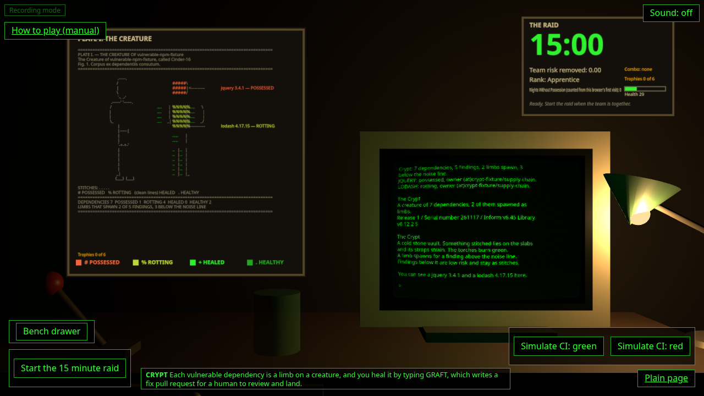
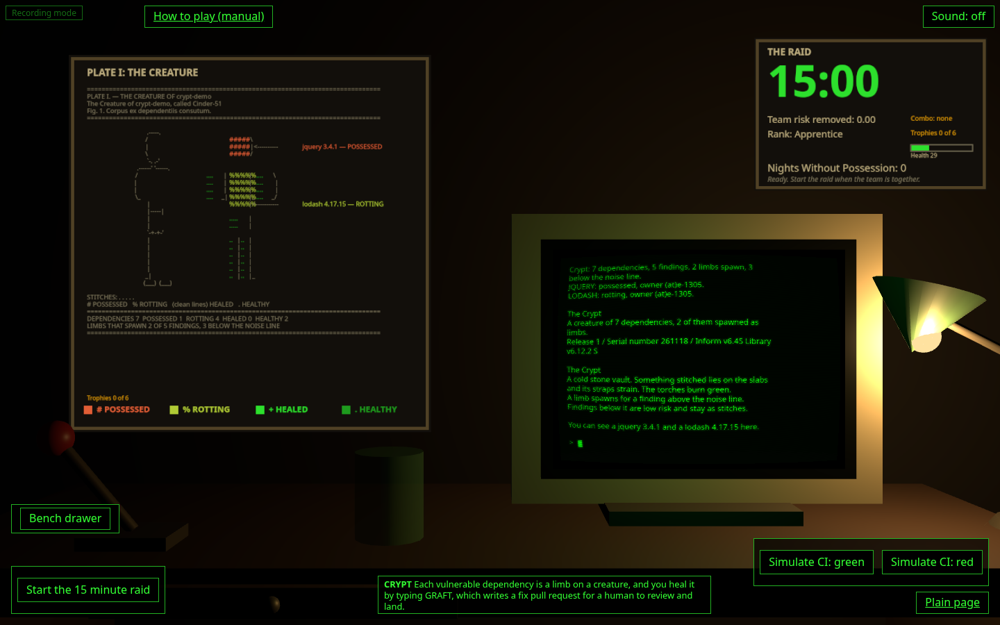
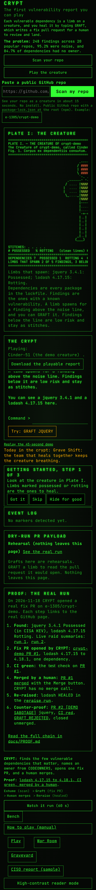

# Nobody owns the monster: building CRYPT with Kiro

Live demo: [e-1305.github.io/Crypt](https://e-1305.github.io/Crypt/)

## Frankenstein, ownership, shame, control

Every repository is a creature stitched together from other people's parts. A lockfile with a few hundred entries is a body with a few hundred limbs, and some of them are rotting. Mary Shelley's story is mostly about what happens after the stitching: Victor Frankenstein builds the creature, then walks away from it. The harm comes from nobody owning the result.

That became the first pillar of CRYPT. Every rotting limb (a dependency with a known vulnerability) gets a named owner, taken from `CODEOWNERS` and from nowhere else.

The second pillar is about tone. Nadya Bartol's TED@BCG talk (2021) is the source of the blameless pillar, which asks who will heal a problem instead of who caused it. The repo holds no quote from the talk. Pullen's TED talk is also credited for the same framing. The repo contains no quote from it either, so I won't invent one. The rule that came out of it is simple: CRYPT never reads git blame and never prints a commit author next to a vulnerable line. Rot belongs to the limb. People are named only in praise, as in "healed by".

The third pillar is control. Saltzer and Schroeder's 1975 paper on protecting information lists design principles such as fail-safe defaults and least privilege. CRYPT applies them directly. On any error, timeout or ambiguity it changes nothing. The code never calls a merge endpoint. One dependency gets one pull request, and one raid opens at most five. A human merges. If someone types `SEAL CRYPT`, every agent action stops.

The game itself is a real Z-machine text adventure, the 1979 Infocom virtual machine. You walk the creature, `EXAMINE` a limb, `ASSIGN` an owner, `GRAFT` a fix. A graft becomes a pull request. A limb counts as healed only after CI is green and a human has merged.

## How Kiro was used

I wrote the spec before the code for the bridge, and usually elsewhere. The `.kiro/specs/` folder holds one folder per piece of work, each with requirements, design and tasks: the bridge between the game and the agents, exhume and rank, raise the creature, the necromancer agent, the web player, the live raid, the operating theatre, and the census. The merge fix below landed spec and code in one commit. When a design turned out wrong, I fixed the spec first and the code second. The bridge story below is the clearest case.

Steering files in `.kiro/steering/` carry the rules that must never drift. `failsafe.md` holds the eight Saltzer and Schroeder rules, and `blameless.md` holds the Bartol rules. `sla-policy.md` fixes the ranking order, and `tech.md` and `product.md` set the scope. Because they are always included, every session started with the same constraints. The failsafe file also says each rule needs a property-based test, so each one has a vitest and fast-check test that runs in CI.

Counts: <!-- stats:start -->20 specs in `.kiro/specs/`, 5 steering files, 5 hooks, 2 custom agents and 678 tests (passed plus skipped, `npx vitest run`; counted by `npm run kiro:stats`)<!-- stats:end -->. The hooks in `.kiro/hooks/` are: attribution on package save, a blameless copy check, a failsafe guard, related tests on save, and a trace check on the tasks file. The agents are `necromancer` and `inquisitor`. The writer of a fix and the verifier are separate on purpose, which is the separation of privilege rule.

One limit, stated plainly, because `docs/KIRO.md` states it too: no hook has been seen to fire inside a Kiro session. Every hook now logs each run to `docs/evidence/hook-runs.jsonl`. In Kiro Web, saving matching files wrote no line, so the lines there are my hand runs, marked `manual`. The safety claims rest on the tests in CI. I also have no measurement of time saved, so I won't claim one.

## What the Census found

To see whether the idea holds up outside my own fixtures, I scanned 20 popular open-source projects at pinned commits. Only root manifests and `CODEOWNERS` files were read as text. Nothing was installed or run. The numbers below come from `docs/census/RESULTS.md`, and `npm run census` reproduces them. Advisories change daily, so a rerun on another day will differ.

- 11,244 limbs (dependencies) across the 20 repositories.
- 248 findings, which is 2.2% of limbs.
- The noise filter exorcised 236 of them (95.2%), and 3 spawned as monsters. Those 3 are 1.2% of findings.
- 0 limbs were possessed, meaning none were in the CISA KEV catalogue of actively exploited vulnerabilities.
- 9,528 limbs (84.7%) had no `CODEOWNERS` owner. 16 of the 20 repositories had no `CODEOWNERS` file at all.

The ownership number surprised me more than the vulnerability number. Most of these dependency trees have nobody listed to heal anything, so the first pillar is a real gap, not just a theme.

The limits matter as much as the numbers. The scan reads lockfiles only. A finding means the locked version has a known advisory, not that the vulnerable code runs. Twenty popular projects are not a random sample of all software. The results are aggregates, and no project is named next to a finding, following the blameless rule.

## What broke, and how it got fixed

**The bridge read the player's own typing.** The first version of the bridge watched the game transcript for lines starting with `> `, treating them as commands. The problem is that a driver script, or a player, can write those lines too. The watcher could act on input that the game never accepted. Issue #3 tracked it. Bridge v2 reverses the direction: the game prints a `[[CRYPT ...]]` marker only when an action has been accepted, and the watcher triggers on markers alone. The spec in `.kiro/specs/bridge-v2/` came first. It also helped the web player, where the event log is fed only by the parser of game output, so typed text cannot fake a marker.

**A clean row hid an unknown one.** The ranker could get several rows for one limb. Before commit `7111955`, those rows were not merged worst-case, so a row saying "known clean" could sit beside a row saying "status unknown" and win. That breaks the fail-safe rule, since an unknown limb must never be called clean. The fix is `mergeOsvAnswers` in `src/exhume/rank.ts`. Unknown now beats known-clean, and the test file gained cases for it. The census counts 9 unresolved findings, kept as findings rather than treated as clean, which is that rule at work.

**The text was in the wrong font.** Commit `733d099` (#60) fixed a quiet one. The 3D scene draws labels onto canvas textures. Those draws ran before the JetBrains Mono font had loaded, so the plates used a fallback proportional font instead of a monospace one. The fix has three parts. The font is now self-hosted. `ensureFonts()` in `web/theatre/font.js` is awaited before any canvas draw. And `scripts/ci/visual-qa.mjs` plus `tests/webfont.test.ts` assert that the text is monospace, so CI catches a regression.

## What I would tell another builder

Write down what the system must never do, and put it where every session sees it. Make each of those rules a test. Treat "unknown" as its own state, and give it the safe default. Last, check the output you show people, whether that is a font or a number, against the thing that produces it.

CRYPT is open source. Try the [live demo](https://e-1305.github.io/Crypt/), or run `npm run census` and compare with the table in `docs/census/RESULTS.md`.
